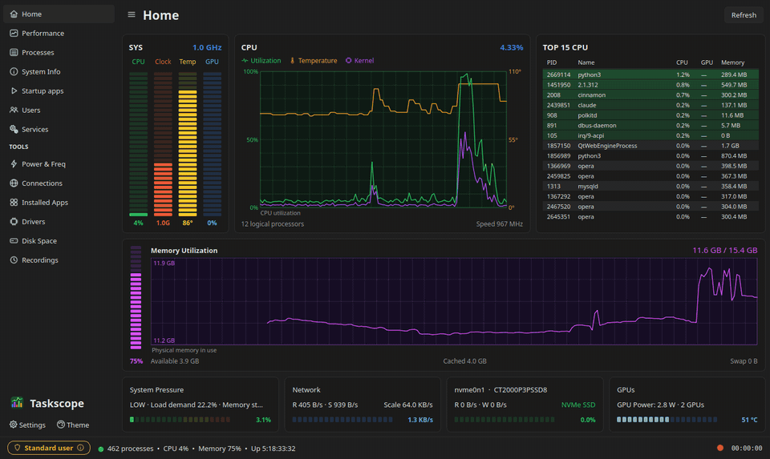
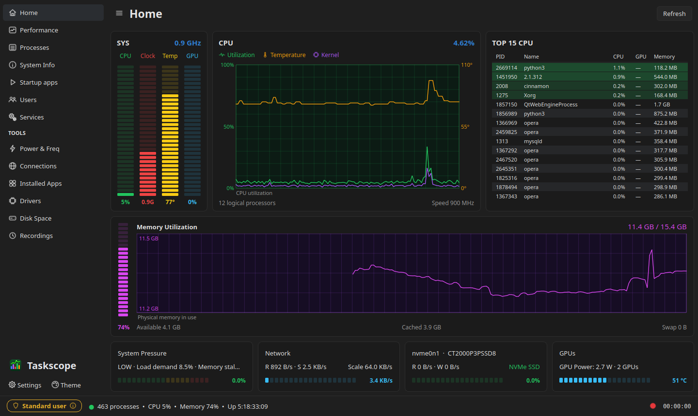
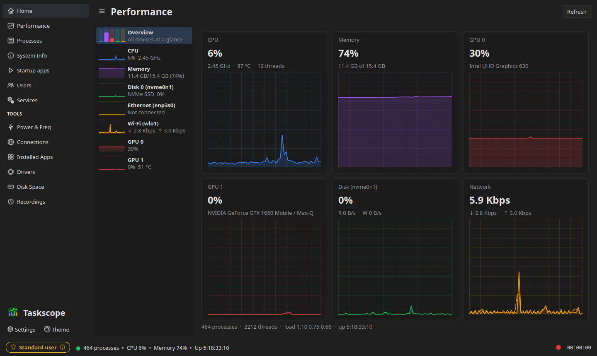
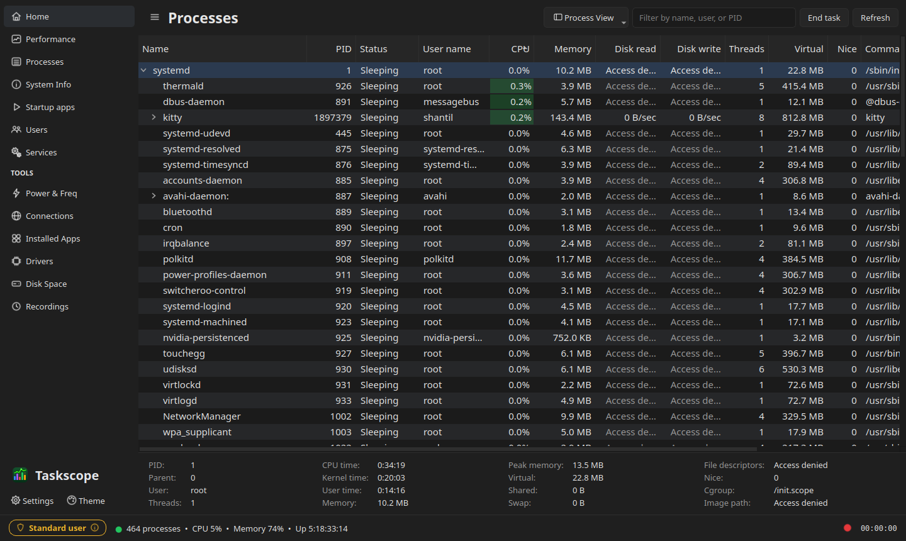
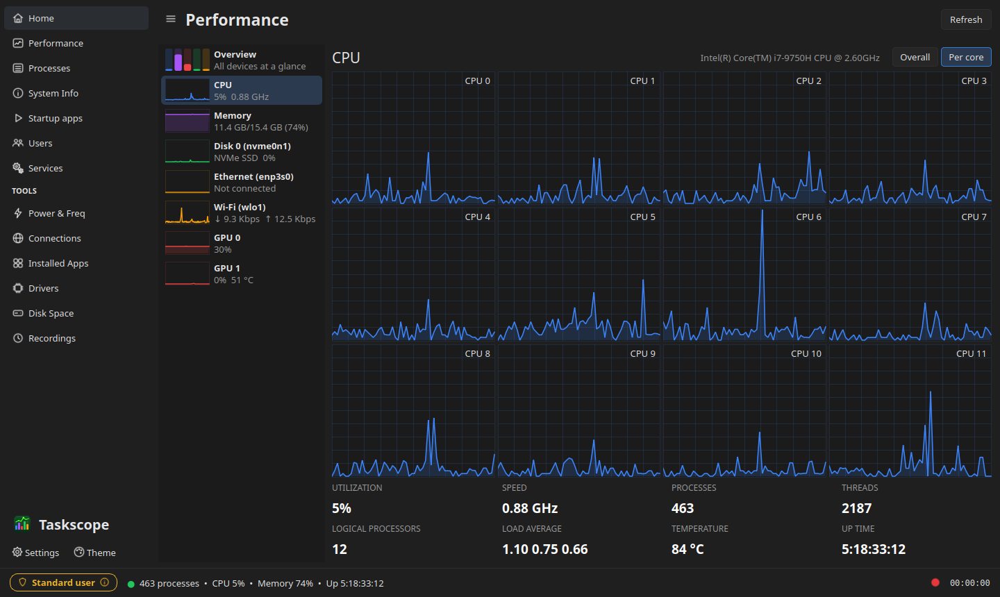
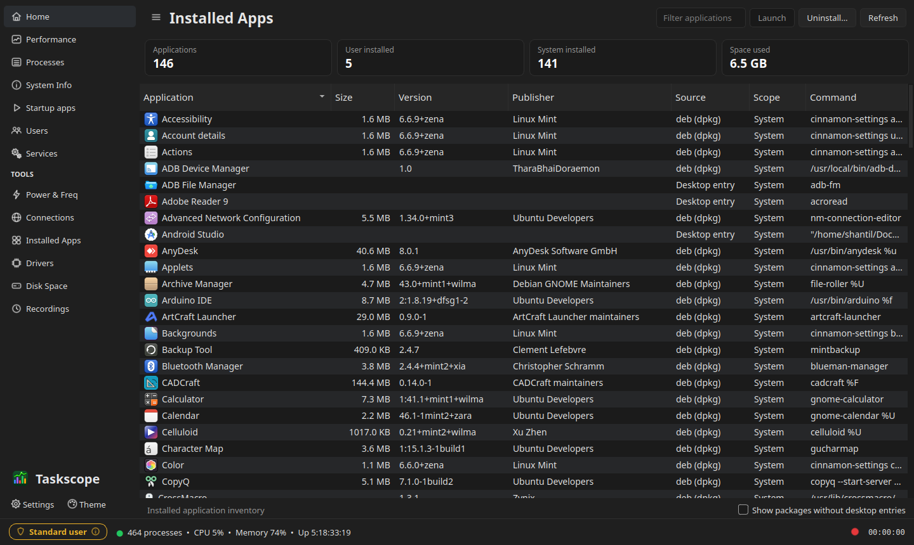
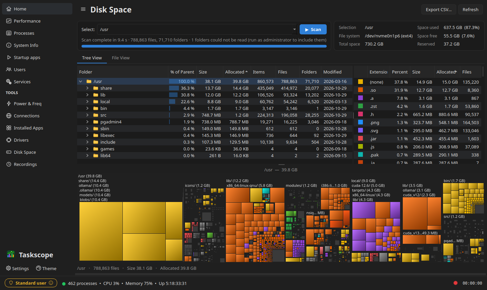
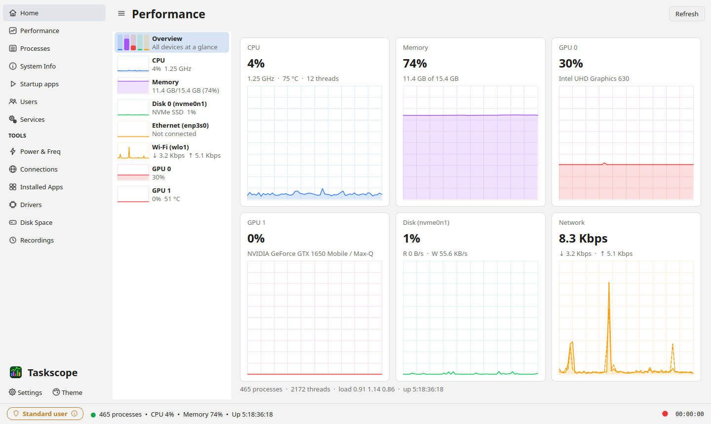

  

<h1 align="center">Taskscope</h1>

  <b>A fast, friendly task manager for Linux.</b> 
  See what your computer is doing and take control of it, on any distro.

  
  
  
  

  <a href="https://github.com/Shantil-K/Taskscope/releases/latest"><b>Download</b></a> ·
  <a href="#screenshots">Screenshots</a> ·
  <a href="#what-it-can-do">Features</a> ·
  <a href="#install">Install</a>

  
   
  <a href="docs/images/demo.mp4">▶ Watch the demo in full quality (MP4)</a>

## Why Taskscope?

- **Everything in one window.** Processes, live graphs, services, startup apps,
  installed apps, drivers, network connections and disk usage.
- **Light on your computer.** It reads the kernel's own files directly instead of
  running other programs, and it uses about 2–3 % of one CPU core even while
  minimised.
- **Works on your distro.** Ubuntu, Mint, Debian, Fedora, openSUSE, Arch,
  Alpine, Void, Gentoo, Solus… When a tool is missing, Taskscope falls back to
  another way of getting the same information.
- **Free and open source**, under the GNU GPL v3.

## Screenshots

<table>
  <tr>
    <td width="50%"> <b>Home:</b> the whole system at a glance. Click a graph to go back in time.</td>
    <td width="50%"> <b>Performance:</b> live graphs for the CPU, memory, disks, network and every GPU.</td>
  </tr>
  <tr>
    <td> <b>Processes:</b> a tree of everything running, with end, kill, pause and priority.</td>
    <td> <b>CPU:</b> one graph per core, plus speed, temperature and load.</td>
  </tr>
  <tr>
    <td> <b>Installed Apps:</b> every app with its size. Launch or uninstall it from here.</td>
    <td> <b>Disk Space:</b> find out what's filling your drive, with a colour map of every file.</td>
  </tr>
  <tr>
    <td colspan="2" align="center"> <b>Themes:</b> dark, light and seven more, with any accent colour.</td>
  </tr>
</table>

## What it can do

**Watch your system**
- **Home:** CPU, memory, temperature, GPU and the busiest apps on one screen,
  with a few minutes of history you can click back through.
- **Performance:** live graphs for the CPU (overall or per core), memory, each
  disk, each network adapter and each GPU (NVIDIA, AMD and Intel).
- **Power & Freq:** clock speeds, temperatures, fans and power use for every
  sensor.
- **Connections:** which apps are talking to the network, and to where.

**Take control**
- **Processes:** end, kill, pause or re-prioritise anything, and see its details.
- **Services** and **Startup apps:** start, stop, enable or disable them.
- **Installed Apps:** see what's installed and how much space it takes. Launch
  or uninstall apps with the package manager that installed them.
- **Run as administrator** when you need to see or change everything.

**Dig deeper**
- **Disk Space:** scan a drive or folder, explore it as a tree or a colour map,
  find duplicate files and move what you don't need to the Trash.
- **Recordings:** record what your system does, then replay it later, like a
  video of your system's activity.
- **System Info** and **Drivers:** your hardware, distro and every kernel module.

**Little extras**: a mini monitor that floats above other windows, a live icon
in the notification area, a screensaver, a read-only web page you can check
from your phone, and a terminal mode for when there's no desktop.

All the details, and how each page reads your system, are in
[docs/FEATURES.md](docs/FEATURES.md).

## Install

Download the package for your distro from the
[latest release](https://github.com/Shantil-K/Taskscope/releases/latest), then:

| Distro | Command |
|---|---|
| Ubuntu, Linux Mint, Debian, Pop!_OS | `sudo apt install ./taskscope_*_all.deb` |
| Fedora, RHEL | `sudo dnf install ./taskscope-*.noarch.rpm` |
| openSUSE | `sudo zypper install ./taskscope-*.noarch.rpm` |
| Arch, Manjaro, EndeavourOS | `sudo pacman -U taskscope-*-any.pkg.tar.zst` |
| Alpine | `sudo apk add --allow-untrusted taskscope_*_noarch.apk` |

Then open **Taskscope** from your app menu, or run `taskscope`.

**Any other distro:** download the source, then run `./install.sh`. It
installs what Taskscope needs with your package manager. Or just try it
without installing: `python3 -m taskscope` in the source folder.

## Tips

- Press `Ctrl+1` … `Ctrl+9` to jump between pages, and `Ctrl+F` to filter any list.
- Some details, like other users' disk activity, need **Run as administrator**
  (Settings → Actions).
- Pick a theme and accent colour with the **Theme** button at the bottom of the
  sidebar.
- More shortcuts and the command-line options are in
  [docs/DEVELOPMENT.md](docs/DEVELOPMENT.md#keyboard-shortcuts).

## Contributing

Bug reports and pull requests are welcome. See
[docs/DEVELOPMENT.md](docs/DEVELOPMENT.md) for running from source, the tests,
and how releases are made.

## License

Taskscope is free software under the **GNU GPL v3 or later**. See
[LICENSE](LICENSE).

About its origin

Taskscope is an independent project written from scratch. It contains no code,
icons, artwork or names from any proprietary task manager, and it wasn't made by
decompiling or disassembling one. It is **not affiliated with Task Manager TMOG
or Plummers' Software LLC**, and it doesn't use or interact with their program,
licence keys or servers.

Qt bindings keep their own licences (PyQt: GPL v3 / commercial; PySide: LGPL
v3 / commercial), which are compatible with Taskscope's. Optional tools such as
`nvidia-smi` and `lspci` run as separate programs and aren't included.

